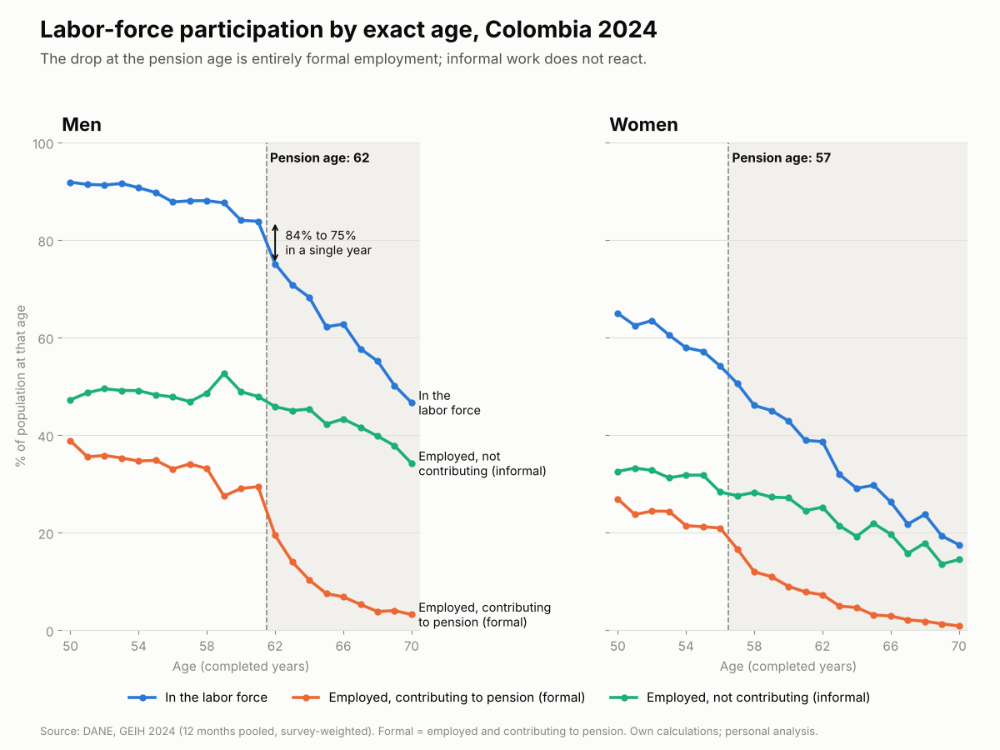

# What happens at Colombia's pension age? A regression-discontinuity look at the GEIH

Colombia's pension eligibility age is 57 for women and 62 for men. This repo lines
people up by exact age in the 2024 GEIH household survey and measures what happens
to labor-force participation, formal employment and informal employment right at
those cutoffs.



## Main results

Local linear regression discontinuity, bandwidth ±5 years, survey-weighted,
heteroskedasticity-robust standard errors. Jumps in percentage points of the
population at that age.

| Outcome | Men, cutoff 62 | Women, cutoff 57 |
| --- | --- | --- |
| In the labor force | −8.0 (se 1.3) | −2.0 (se 1.5) |
| Employed | −8.2 (se 1.5) | −1.7 (se 1.5) |
| Employed, contributing to pension (formal) | −8.5 (se 1.6) | −3.9 (se 1.3) |
| Employed, not contributing (informal) | −3.8 (se 1.7), not robust to bandwidth | −0.4 (se 1.4) |
| Employed and already receiving a pension | +4.1 (se 0.6) | +2.6 (se 0.4) |

Placebo cutoffs (57, 60, 65 for men; 55, 60, 62 for women) are all
indistinguishable from zero. Results are stable for bandwidths of 3 and 8 years.

## Data

DANE, Gran Encuesta Integrada de Hogares (GEIH) 2024, monthly anonymized microdata.
Download it from the DANE microdata catalog (<https://microdatos.dane.gov.co>),
search for "GEIH 2024", and save the CSV files with this layout:

```
geih_2024/
  enero/
    caract_ss_edu.csv
    fuerza_de_trabajo.csv
    ocupados.csv
  febrero/
    ...
```

The microdata is not redistributed here. Variables used:

| Module | Variable | Meaning |
| --- | --- | --- |
| Características generales | `P6040` | Age in completed years |
| Características generales | `P3271` | Sex (1 = man, 2 = woman) |
| Características generales | `FEX_C18` | Survey weight |
| Fuerza de trabajo | `FT` | 1 = in the labor force |
| Ocupados | `OCI` | 1 = employed |
| Ocupados | `P6920` | 1 = contributes to pension, 2 = does not, 3 = already pensioned |

## How to run

1. Open `RD_Edad_Pension_GEIH.R` in RStudio or VS Code.
2. Edit the two paths at the top (`RAIZ_GEIH`, `CARPETA_SALIDA`).
3. Run the script. Base R only, no packages. About 15 seconds for the 12 months.

Outputs: `tasas_por_edad_sexo.csv` (weighted rates by single year of age and sex),
`resultados_rd.csv` (all estimates and placebos), and two PNG charts.

`extras/grafico_linkedin.py` rebuilds the English, LinkedIn-sized version of the
chart from `tasas_por_edad_sexo.csv` (needs pandas and matplotlib).

## Method in one paragraph

Someone aged 61 and someone aged 62 are nearly identical except that the latter
can claim a pension. Fitting a separate line to each side of the cutoff and
measuring the gap between them exactly at the threshold isolates the effect of
eligibility from the smooth decline in participation with age. Because age is
recorded in completed years, the treatment year mixes 0 to 11 months of
eligibility, so the estimates understate the true jump somewhat. The design
identifies the effect of *becoming eligible by age*, not of receiving a pension:
many people reach the age without the required contribution weeks, which is why
the effect is smaller for women.

## Caveats

- `P6920` is only asked of the employed, so "already pensioned" means
  pensioned and still working.
- Ley 2381 de 2024 (the pension reform) takes effect in July 2025 and keeps
  the eligibility ages, so 2024 is a clean pre-reform baseline.
- Personal analysis with public data. It does not represent the views of any
  employer.

## License

Code under the MIT License. Data belongs to DANE.
